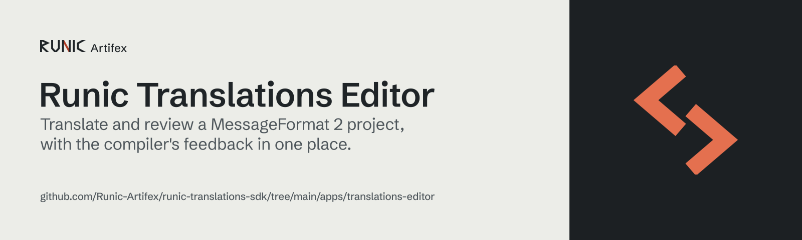

# Runic Translations Editor

Translate and review the same MessageFormat 2 project that application builds consume. Browse locale coverage, search messages, edit patterns and variables, preview changes, manage review state, and resolve compiler feedback in one place while keeping ordinary `.mf2` files readable in Git and any text editor.

Runic Translations Editor is a companion to [Runic Translations](../../packages/dotnet/Runic.Translations/README.md). The editor manages workspaces; the compiler, schema, runtime, CLI, and language integrations are published by the SDK.

See the [editor architecture](docs/architecture.md), [source-build and future
archive guidance](docs/editor-distribution.md), and [usability-study protocol](docs/translator-usability-test.md).

## Availability and local commands

Standalone Editor distributions are not part of the SDK packages. Build the editor from
source using the commands below. The examples here use the executable produced by
that build; SDK package publication does not imply an Editor download.

Open the directory containing `translations/runic.json`, or the translations
directory itself. The editor uses the same compiler path as MSBuild and Vite.
After building from source, use the launch command below with
`validate /path/to/workspace` for compiler-backed
validation: exit codes are `0` for valid, `2` for diagnostics, a missing project
or when validation cannot start, and `3` for an internal failure.

## Headless interchange

Use `export` to write XLIFF or portable review JSON. Use `report` to inspect an import's reviewable diff and refusals without changing the workspace. An XLIFF import updates only the target project's declared translation resources. An import is applied only when `--apply` is explicit; it previews and consumes the confirmation within one process, so no confirmation token is persisted or reusable.

These commands are thin wrappers over the same Tooling code as `runic-translations xliff export`, `xliff import` and `review mark` (the `dotnet-runic-translations` tool): the same XLIFF profile, the same per-unit import rules and the same review file. Use either; the editor's commands add the preview/confirm step.

```bash
./runic-translations-editor export /path/to/workspace --interchange xliff --output .runic-translations/export
./runic-translations-editor report /path/to/workspace --interchange xliff --source .runic-translations/export/catalog.en.xliff
./runic-translations-editor import /path/to/workspace --interchange xliff --source .runic-translations/export/catalog.en.xliff --apply

./runic-translations-editor export /path/to/workspace --interchange review --output .runic-translations/export/catalog.review.json
./runic-translations-editor report /path/to/workspace --interchange review --source .runic-translations/export/catalog.review.json
```

`--output` belongs to `export`. A relative `--output` is resolved under the workspace; an absolute path is used as given. Select the command response envelope with `--format json` (or `RUNIC_COMMANDLINE_OUTPUT=json`). `--runic-output`, the spelling before 0.8, is still accepted but not listed in help. `--interchange` was `--format` before 0.8. An XLIFF import updates only the selected project's declared `.mf2` or `.rmf2` translation resources. A report or import that is refused returns exit code `2` and lists its refusal codes in both human output and the JSON fault details.

## Local support diagnostics

Run `diagnostics <workspace>` to create the existing privacy-bounded diagnostic ZIP for an explicit local support collection. The command never uploads it. Use `runic-translations support preview|collect|remove --editor-diagnostics <zip> --destination <path>` (the `dotnet-runic-translations` tool) to inspect, collect, or remove a local unsigned support envelope. The interface language starts from the operating system's preferred languages, matched against the editor's own languages (English and German), and the choice is kept; it is also the window's language, so native surfaces follow it. The editor stores preferences, recents, and recovery drafts in one native per-user record, not a browser profile; it is atomically replaced and an unreadable record is quarantined on next launch. In the editor’s **About & diagnostics** panel, **Local editor state** reports only entry counts and bytes; use **Clear local state** to remove those records without changing workspace files or current in-memory work.

## What it supports

The editor opens conventional `runic.json` projects, validates and saves their
MF2 messages, watches external changes, and previews through the canonical
compiler model. Diagnostics remain privacy-bounded and writes use revision
checks plus atomic replacement.

The editor uses the RMF2 v5 compiler/runtime pipeline without fabricating a
retired catalog carrier. Previews are formatted by the verified .NET artifact/pack
path; the browser receives validated inert semantic runs and never approximates
AST 5 in JavaScript. Editor refactors and XLIFF imports are resource-only: they
do not rewrite application call sites.

The preview formats as the runtime does: with the catalog's bidi isolation, for a
**regional locale** a user requests (`de-CH` for `de` text gets Swiss numbers and
dates) and in a chosen **time zone** for `timeZone=local`; it names the formatting
locale beside the text. The pseudo-localization simulation and the `pseudoLocales`
that `runic.json` configures (`en-XA`, `ar-XB`, listed as generated, read-only
languages) are rendered by the SDK's pseudo-locale generator, exactly as a
`--pseudo-locales` build produces them. The language list shows the coverage of
`runic-translations status` (translated, from a fallback locale, missing, stale, and
whether missing translations are errors). Adding a language suggests the SDK's CLDR
locales, names the CLDR data a tag formats with (`zh-TW` uses `zh-Hant-TW`) and the
plural and ordinal categories it needs, and gives copied starter messages those
categories. For a region tag whose CLDR data is in another script it offers the
script-level locale that runtime negotiation resolves the region to (`zh-TW` and
`zh-HK` → `zh-Hant`, `sr-ME` → `sr-Latn`); the typed tag stays unless you choose it.
For both, it lists the requested tags that would reach the locale under the
catalog's `runtime.unsupportedLocale`: under `exact` a locale serves only its own
tag, so an app whose platforms send `zh-TW` declares `zh-TW`. The starter copies
of a new language are recorded as `draft` in the review file, so its coverage
starts at what it really translates, not 100 %; saving an edited starter message
records it `translated` (as `runic-translations review mark --state translated`
does), and `status` counts a `draft` translation as missing. Adding and removing
languages runs the same code as `runic-translations locale add|remove` and keeps
`runic.json`'s formatting; a review file that cannot be read or updated is named in
a notice. **Import from .resx or i18next** (in **Interchange**, and as a step of the
new-project wizard) runs `runic-translations import`'s importer: a dry run lists
each message's outcome before a one-use confirmation writes it. Changing the format,
the source or **Overwrite** discards the dry run, so the import applies only a plan
made for the inputs shown; errors the catalog already had are listed as such. The
editor and the language server read `runic.json` as the compiler does: a UTF-8 BOM
is skipped and a duplicate member is the compiler's diagnostic.
The closed XLIFF 2.1 profile (version 3, shared with `runic-translations xliff`)
deterministically round-trips plain RMF2 messages, with placeholders as `<ph>`,
reports structured messages as semantic loss and skips them on import instead of
flattening them. Imports are judged per unit, as `runic-translations xliff import`
judges them: untranslated units are skipped, an invalid unit is refused and listed
while the other units are imported, and a unit whose source changed since export
is imported as needs-review. Only document-level problems (another catalog, an
undeclared or the base locale, an unreadable file) refuse the whole import.

Review states live in the SDK review file `<catalog>.review.json` beside
`runic.json`, the file `runic-translations review mark`, `xliff import`,
`validate` and the language server use. Each state records the per-unit
fingerprint of the base text the editor loaded when you set it; when that source
changes, the row is marked **Source changed** and its quality checks show
`RTR0090`. If the base text changed on disk after the editor loaded it, saving
records your state for the text you saw, so it shows as stale instead of
approving text nobody reviewed. Review data works while the catalog has errors
elsewhere, such as a locale that misses keys: only errors in `runic.json` or the
base locale stop review states from being recorded. A row's note is stored on its
review entry, so an edited or cleared note (also one from XLIFF) is what export
writes; a note or preview samples alone create no review entry. Preview samples,
terminology and the notes of rows without a review entry stay in the editor's own
`.runic-translations/<catalog>.editor-state.json` (`runic.translations.editor-state/2`).

The editor checks the review file for changes by other writers while it is open:
without unsaved review changes it reloads the review data; with them, your
changes are kept on top of the file's, and saving refuses only an entry that
changed both in the editor and on disk.

When the editor opens a project with a version 1 editor state, it moves the
review states into the review file once: an approval whose base text is
unchanged stays approved, every other recorded state whose base text changed
becomes needs-review, and states of removed or renamed messages are dropped. The
version 1 file is kept as `.runic-translations/<catalog>.editor-state.v1.json`,
and a notice counts the states that moved, need review, were dropped or were
already in the review file. Until `runic.json` and the base locale have no
errors, the version 1 states are shown read-only.

The quality filter and each row's quality checks show the compiler's
per-message diagnostics (`RTR0010` untranslated, `RTR0094`–`RTR0098`, and
`RTR0090` stale review state) beside the editor's own checks (identical to the
source, boundary whitespace, terminology, bidirectional text). `RTR0095` offers
a quick fix that adds the missing plural or ordinal variants as copies of the
`*` variant.

## Catalogs and library catalogs

The editor finds every `runic.json` below the workspace directory, by the same
rules as the language server (build output, `node_modules`, VCS and tool
directories are skipped). It opens `runic.json` or `translations/runic.json` at
the top, or the only project; with several and none at the top, the welcome
screen lists them. The **Catalogs** section of the sidebar switches between
them; each catalog keeps its own selected message, locale, filter and search.

The same section lists the open project's **library catalogs**: catalogs that an
installed package packs (a restored NuGet package's `runic/<catalog>/`, or an npm
dependency's `runicTranslations`), found through the restore output and
`node_modules` as the build and the Vite plugin find them; restore the project
first. **Libraries…** shows a library catalog in two layers: the library's text
(layer 0) is read-only, and your overrides (layer 1) are the
`translations/overrides/<catalog>/<locale>.rmf2` files the build compiles into
the application. **Override** opens the message's text, pre-filled with the text
the locale shows now; **Save** writes it to that file with the library's base
text as comments, so a click alone does not pin the library's current text. The
first override of a catalog adds it to runic.json `"overrides"` in the same
write, which the editor does not report as an external change; with unsaved work
the page asks you to reload once it is saved. An override shows an
**Overridden** badge, can be edited and saved, and **Revert to library** removes
it. Each override records the library text it was written for, its base text and
the locale's text (`translations/overrides/<catalog>/<catalog>.review.json`);
after a library update that changes either, the override is marked **Library
text changed since override** (`RTR0090`) until you **Keep override**. Save,
Override, Revert and Keep send the revision of the file they were shown from: if
it changed on disk meanwhile (an edit in VS Code, the command line), nothing is
written, your typed text stays, and **Reload library** shows the current state.
A text that is not valid RMF2 is refused and stays in place with the error.
Catalogs and drafts are kept per `runic.json`. **Add locale** adds a locale
the library lacks (the tag is canonicalized, `fr-ca` becomes `fr-CA`, and
selected); it falls back by the rule of the compiler and both runtimes
(its nearest CLDR parent among the library's and your locales, then the library
locale CLDR likely subtags match, then the base locale) and is built once it has
its first override. Each locale shows how many of the library's messages it shows
in its own text. The build's diagnostics of your overrides (unknown keys
`RTR0103`, changed inputs) are listed below.

Machine-translation providers and signed stable distribution are not available yet.

## Build from source

Use the locked Translations SDK toolchain and run these commands from this
repository's root. On NixOS, inspect `.envrc` and `flake.nix`, allow the environment,
then use `direnv exec .` as shown:

```sh
direnv allow
direnv exec . bun run bootstrap
direnv exec . bun run build
nix develop .#editor -c dotnet run --project apps/translations-editor/Runic.Translations.Editor.csproj \
  --configuration Release --no-build -- edit /path/to/workspace
```

`bun run build` produces the Release editor and its packaged frontend. Replace
`edit /path/to/workspace` with `validate /path/to/workspace` for a headless first-run
check, or with `--help` to inspect the supported commands. The `dotnet run` command
also launches on Windows or macOS with the corresponding .NET, Node, and Bun
toolchain available; native UI launch requires the platform's windowing runtime.
The default `direnv` shell supplies the build and CLI toolchain. The optional
`nix develop .#editor` shell adds Chromium, GTK 3/WebKitGTK 4.1, GIO/TLS modules,
and GStreamer from this repository's locked nixpkgs; it sets `CSWEBUI_BROWSER_PATH`,
so `edit` opens that Chromium, and `WEBUI_BROWSER_PATH` for hosted browser acceptance.
It does not require another repository's shell.
`edit` opens an installed browser in app mode; add `--webview` to request the
embedded WebView instead. On Linux, interactive launch needs a running X11 or
Wayland desktop session; native chooser services also need that session's D-Bus
and configured XDG portal backend. On Linux, **Browse** chooses a workspace folder
through the first of these that is available: the portal's FileChooser (version 3 or
newer, for example from `xdg-desktop-portal-gnome`, `-kde` or `-gtk`), then
`/usr/bin/zenity` when the session has no such FileChooser or no session bus. Without
either, enter the workspace directory instead. Windows and macOS show their system
folder dialog. The shell supplies tools and libraries without starting those services or
selecting the session's backend.

On Linux without Nix, provide a supported Chromium browser for normal `edit`,
GTK 3 and WebKitGTK 4.1 for `--webview`, and the session services above. To choose
the browser `edit` opens, set `CSWEBUI_BROWSER_PATH` to its executable; it is then
used without fallback. For the
hosted acceptance harness, explicitly set `WEBUI_BROWSER_PATH` to your browser's
executable. The [hosted acceptance guide](tests/HostedBrowserE2E/README.md) explains
the reproducible Nix workflow. Headless browser acceptance and editor smoke tests
exercise application behavior; they do not certify interactive Linux desktop
launch, embedded WebView, or native chooser behavior.

The shell examples elsewhere on this page use the standalone launcher's name;
when running from source, pass those arguments after the `--` above.

Translations dependencies resolve from source in this repository. Runic Command
Line and the Runic SDK packages (Views with its CS-WebUI host and ReactiveUI
adapter, Navigation, Platform) and their npm counterparts resolve from
independently pinned published packages; the editor is built on Runic SDK 0.17.1
(NuGet and npm, which must match: Bridge protocol 3 is a strict version match).
No sibling SDK checkout is needed. The native transport is published `CsWebUi` and
`CsWebUi.Native` `[2.5.0-beta.4.9, 3.0.0)`, the floor of Runic SDK 0.17.1's
CS-WebUI host (an exact `2.5.0-beta.4.8` pin was a downgrade, NU1605). These
resolve through the repository's ordinary NuGet.org configuration.
`bun run test` checks the frontend, generated Views client, editor save/recovery smoke and example workspace.
`bun run verify-packages` checks the SDK's isolated package consumers. See the
[contributor guide](../../CONTRIBUTING.md) for the complete verification sequence.

For frontend-only development, build once to generate the localized ESM module,
then run this from the SDK root:

```sh
RUNIC_TRANSLATIONS_MANIFEST="$PWD/apps/translations-editor/obj/Release/net10.0/translations/editor.esm-v5/web-module-manifest-v3.json" \
  direnv exec . bun run --cwd apps/translations-editor/Frontend dev:mock
```

Mock mode keeps writes in memory.

## Support and license

Report reproducible editor problems through [GitHub Issues](https://github.com/Runic-Artifex/runic-translations-sdk/issues). Please include your platform, source revision and `--version` output, and safe-to-share validation output; do not include translation text or workspace paths in public reports.

Runic Translations Editor is released under the [MIT License](../../LICENSE). See [third-party notices](THIRD-PARTY-NOTICES.md) for bundled dependency notices.
