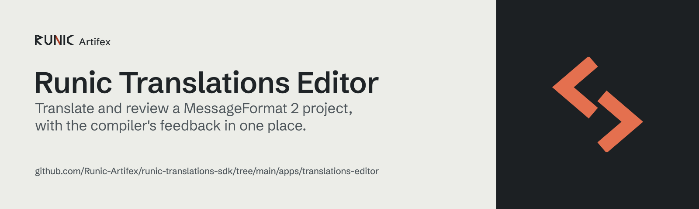

# Runic Translations Editor

Translate and review the same MessageFormat 2 project that application builds consume. Browse locale coverage, search messages, edit patterns and variables, preview changes, manage review state, and resolve compiler feedback in one place while keeping ordinary `.mf2` files readable in Git and any text editor.

Runic Translations Editor is a companion to [Runic Translations](../../packages/dotnet/Runic.Translations/README.md). The editor manages workspaces; the compiler, schema, runtime, CLI, and language integrations are published by the SDK.

See the [editor architecture](docs/architecture.md), [source-build and future
archive guidance](docs/editor-distribution.md), and [usability-study protocol](docs/translator-usability-test.md).

## Availability and local commands

Standalone Editor distributions are not part of the SDK packages. Build the editor from
source using the commands below. The examples here use the executable produced by
that build; SDK package publication does not imply an Editor download.

Open the directory containing `translations/runic.json`, or the translations
directory itself. The editor uses the same compiler path as MSBuild and Vite.
After building from source, use the launch command below with
`validate /path/to/workspace` for compiler-backed
validation: exit codes are `0` for valid, `2` for diagnostics, a missing project
or when validation cannot start, and `3` for an internal failure.

## Headless interchange

Use `export` to write XLIFF or portable review JSON. Use `report` to inspect an import's reviewable diff and refusals without changing the workspace. An XLIFF import updates only the target project's declared translation resources. An import is applied only when `--apply` is explicit; it previews and consumes the confirmation within one process, so no confirmation token is persisted or reusable.

These commands are thin wrappers over the same Tooling code as `runic-translations xliff export`, `xliff import` and `review mark` (the `dotnet-runic-translations` tool): the same XLIFF profile, the same per-unit import rules and the same review file. Use either; the editor's commands add the preview/confirm step.

```bash
./runic-translations-editor export /path/to/workspace --interchange xliff --output .runic-translations/export
./runic-translations-editor report /path/to/workspace --interchange xliff --source .runic-translations/export/catalog.en.xliff
./runic-translations-editor import /path/to/workspace --interchange xliff --source .runic-translations/export/catalog.en.xliff --apply

./runic-translations-editor export /path/to/workspace --interchange review --output .runic-translations/export/catalog.review.json
./runic-translations-editor report /path/to/workspace --interchange review --source .runic-translations/export/catalog.review.json
```

`--output` belongs to `export`. A relative `--output` is resolved under the workspace; an absolute path is used as given. Select the command response envelope with `--format json` (or `RUNIC_COMMANDLINE_OUTPUT=json`). `--runic-output`, the spelling before 0.8, is still accepted but not listed in help. `--interchange` was `--format` before 0.8. An XLIFF import updates only the selected project's declared `.mf2` or `.rmf2` translation resources. A report or import that is refused returns exit code `2` and lists its refusal codes in both human output and the JSON fault details.

## Local support diagnostics

Run `diagnostics <workspace>` to create the existing privacy-bounded diagnostic ZIP for an explicit local support collection. The command never uploads it. Use `runic-translations support preview|collect|remove --editor-diagnostics <zip> --destination <path>` (the `dotnet-runic-translations` tool) to inspect, collect, or remove a local unsigned support envelope. The interface language starts from the operating system's preferred languages, matched against the editor's own languages (English and German), and the choice is kept; it is also the window's language, so native surfaces follow it. The editor stores preferences, recents, and the recovery copies of unsaved work (text drafts and review changes) in one native per-user record, not a browser profile; it is atomically replaced and an unreadable record is quarantined on next launch. In the editor’s **About & diagnostics** panel, **Local editor state** reports only entry counts and bytes; use **Clear local state** to remove those records without changing workspace files or current in-memory work.

## What it supports

The editor opens conventional `runic.json` projects, validates and saves their
MF2 messages, watches external changes, and previews through the canonical
compiler model. Diagnostics remain privacy-bounded and writes use revision
checks plus atomic replacement.

The editor wears the Runic Artifex brand: stone and ink in a light or dark scheme
(or the system's), Schibsted Grotesk for words and Spline Sans Mono for keys and
file names, both bundled so nothing loads from the network. Red-ochre paint marks
only placeholders such as `{$count}`, keyboard focus, links and the selected
message; missing, done, outdated and needs-review translations carry a shape
besides their colour. **Editor settings** chooses the scheme and the **density**:
comfortable (the default) or compact, which tightens spacing, the message tree's
rows and the interface text. The colour palettes of earlier versions are gone; a
stored palette is dropped when the editor loads its local state.

The window is a workbench of three panes. The sidebar holds the project, its
catalogs and languages, and the message tree; the editor column in the middle
holds the selected message's heading, its review workflow (or, when its source
changed after its review state was recorded, the **Source changed** callout
above the workflow), the source text and the composer or the file view; the
rail on the right holds the preview and the diagnostics. The toolbar above the
editor column has **Libraries…**, **Interchange…**, **Next missing**, Undo, Redo
and **Save**. Below a window width of 1100 px the rail folds under the editor
column, and below 768 px the sidebar collapses behind the navigation button at
the start of the toolbar.

**Next missing** (Alt+↓, or ⌥↓ on macOS) selects the next message, in the order
of the message tree, that the selected language lacks; Alt+↑ selects the
previous one. With the **Stale** or **Review** filter on, they step through the
outdated messages or those that need review instead, and the button says
**Next outdated** or **Next to review**. They visit the messages the list shows
(the search and filter apply) and wrap: after the last message comes the first,
and the editor says so. **Save and next** (Ctrl+Enter, or ⌘Enter on macOS) saves
all unsaved work as **Save** does, then selects the next message of the kind the
selected one was: missing, outdated, or the kind of the filter. If the save is
blocked, for example by an error in the text, the message stays selected and the
editor says why. A button next to the composer offers it while the selected
message was missing or outdated when you selected it. The three commands are in
the command palette (Ctrl+K). The shortcuts work outside text fields and in the
composer, the message source and the file view, but not in the search field, a
menu or a dialog; on macOS ⌥↑ and ⌥↓ keep moving the caret in a text field, so
there they work outside text fields only. AltGr is never one of them.

### One-language projects

A project whose `runic.json` declares one language, its base locale, is a
content-editing project: people edit the application's text in that language,
for example the copy of a German-only app, and nothing is translated. Configured
`pseudoLocales` don't count as languages; they stay in the language list for the
preview. In such a project the editor speaks of texts: the list is **Texts**,
the composer says **Edit the text**, and the developers' comment above a message
is shown as **Note from the developers**. It leaves out what only translation
needs: coverage and the languages' marks, the **Missing**, **Stale** and
**Review** filters, **Next missing**, the source panel, **Copy source**, the
review workflow and its stale-state confirmation, and the review commands of the
palette. Length limits, the preview, the issues, Undo, the one **Save** and the
namespace tree stay. **Save and next** (Ctrl+Enter) is always offered and selects
the next text in tree order. The code identifier and the **File** view keep their
developer vocabulary.

A review file such a project kept from the time it had more languages stays on
disk unchanged: the editor neither shows nor writes it. **Add a language**, in the
place of **Manage languages** in the language list, adds a second language as
before; the editor then switches to translation mode without a restart, and the
review file applies again.

The editor uses the RMF2 v5 compiler/runtime pipeline without fabricating a
retired catalog carrier. Previews are formatted by the verified .NET artifact/pack
path; the browser receives validated inert semantic runs and never approximates
AST 5 in JavaScript. Editor refactors and XLIFF imports are resource-only: they
do not rewrite application call sites.

The preview formats as the runtime does: with the catalog's bidi isolation, for a
**regional locale** a user requests (`de-CH` for `de` text gets Swiss numbers and
dates) and in a chosen **time zone** for `timeZone=local`; it names the formatting
locale beside the text. The pseudo-localization simulation and the `pseudoLocales`
that `runic.json` configures (`en-XA`, `ar-XB`, listed as generated, read-only
languages) are rendered by the SDK's pseudo-locale generator, exactly as a
`--pseudo-locales` build produces them. The language list shows the coverage of
`runic-translations status` (translated, from a fallback locale, missing, stale, and
whether missing translations are errors). Adding a language suggests the SDK's CLDR
locales, names the CLDR data a tag formats with (`zh-TW` uses `zh-Hant-TW`) and the
plural and ordinal categories it needs, and gives copied starter messages those
categories. For a region tag whose CLDR data is in another script it offers the
script-level locale that runtime negotiation resolves the region to (`zh-TW` and
`zh-HK` → `zh-Hant`, `sr-ME` → `sr-Latn`); the typed tag stays unless you choose it.
For both, it lists the requested tags that would reach the locale under the
catalog's `runtime.unsupportedLocale`: under `exact` a locale serves only its own
tag, so an app whose platforms send `zh-TW` declares `zh-TW`. The starter copies
of a new language are recorded as `draft` in the review file, so its coverage
starts at what it really translates, not 100 %; saving an edited starter message
records it `translated` (as `runic-translations review mark --state translated`
does), and `status` counts a `draft` translation as missing. Adding and removing
languages runs the same code as `runic-translations locale add|remove` and keeps
`runic.json`'s formatting; a review file that cannot be read or updated is named in
a notice. **Import from .resx or i18next** (in **Interchange**, and as a step of the
new-project wizard) runs `runic-translations import`'s importer: a dry run lists
each message's outcome before a one-use confirmation writes it. Changing the format,
the source or **Overwrite** discards the dry run, so the import applies only a plan
made for the inputs shown; errors the catalog already had are listed as such. The
editor and the language server read `runic.json` as the compiler does: a UTF-8 BOM
is skipped and a duplicate member is the compiler's diagnostic.

In the **Translation** view every locale except the base locale shows the base
text read-only above its field. A message the locale does not have yet opens in
the visual composer on an empty **starter** shaped for that locale: the base
message's declarations and selectors, with one empty variant per plural category
the locale uses (German `one` and `*`; Polish `one`, `few`, `many` and `*`). The
base text is not filled in, the Workflow badge says **Not translated**, and
**Message source** shows the starter. Nothing is written while the starter is
empty. With its first text it becomes ordinary unsaved text of the locale's
document, inserted into the message's existing group, saved by **Save** and kept
for recovery; cleared back to empty before saving, the document is back at its
saved text. **Copy source** fills each variant with the base variant that has the
same keys, else with the base's `*` variant, keeping placeholders, as one edit.
For a message with `@maxLength` the counter shows its text against the limit
(`16 / 24`), counted as `RTR0098` counts it (the literal text of the longest
variant; placeholder values are not counted), and each variant shows its own
length; text over the limit is marked, and the reason is shown next to the field.

The closed XLIFF 2.1 profile (version 3, shared with `runic-translations xliff`)
deterministically round-trips plain RMF2 messages, with placeholders as `<ph>`,
reports structured messages as semantic loss and skips them on import instead of
flattening them. Imports are judged per unit, as `runic-translations xliff import`
judges them: untranslated units are skipped, an invalid unit is refused and listed
while the other units are imported, and a unit whose source changed since export
is imported as needs-review. Only document-level problems (another catalog, an
undeclared or the base locale, an unreadable file) refuse the whole import.

Review states live in the SDK review file `<catalog>.review.json` beside
`runic.json`, the file `runic-translations review mark`, `xliff import`,
`validate` and the language server use. Each state records the per-unit
fingerprint of the base text the editor loaded when you set it; when that source
changes, the row is marked **Source changed** and its quality checks show
`RTR0090`. If the base text changed on disk after the editor loaded it, saving
records your state for the text you saw, so it shows as stale instead of
approving text nobody reviewed. Review data works while the catalog has errors
elsewhere, such as a locale that misses keys: only errors in `runic.json` or the
base locale stop review states from being recorded. A row's note is stored on its
review entry, so an edited or cleared note (also one from XLIFF) is what export
writes; a note or preview samples alone create no review entry. Preview samples,
terminology and the notes of rows without a review entry stay in the editor's own
`.runic-translations/<catalog>.editor-state.json` (`runic.translations.editor-state/2`).

The editor checks the review file for changes by other writers while it is open:
without unsaved review changes it reloads the review data; with them, your
changes are kept on top of the file's, and saving refuses only an entry that
changed both in the editor and on disk.

**Save** (Ctrl+S) saves all unsaved work at once: first the text of every
document you changed, each validated (an invalid document blocks the save, and
nothing is written), then the review changes (states, notes, terminology), so a
review state is recorded against saved text. The toolbar shows one state:
**Saved**, or **Unsaved changes** naming what is unsaved (text in some documents,
review status). Unsaved means "differs from the file": an edit typed back to the
saved text, or a review entry set back to its saved value, is no change. The
Workflow panel's **Discard review changes** drops unsaved review changes. Unsaved
text and review changes are also kept in the native editor state; when the
window is closed or the editor stops without saving, the next start offers them
under **Unsaved work was recovered**, and **Restore** applies the review changes
on top of the review file as it is then (an entry changed there meanwhile is
reported as a conflict when you save).

Closing the window with unsaved work (the title-bar close button, Alt+F4, the
window manager, or **Close window** in the command palette) asks first: **Save
your changes before closing?** names what is unsaved (the documents with unsaved
text, review changes, and the repair of a malformed file, which **Save** does
not include) and offers three answers. **Save and close** runs the one save; a
document with errors blocks it, and a refused or failed save keeps the window
open, which then says why. **Discard and close** drops the work and its recovery
copy, as every other discard does, so the next start offers nothing to restore.
**Cancel** (or Escape) keeps the window open with the work as it is. Without
unsaved work the window closes at once. The question never makes the window
wait for you: the editor keeps the window open as soon as something is unsaved
and closes it only after Save or Discard, so taking your time cannot close it
or lose the work. In a browser (`--browser`, the fallback when the embedded
WebView cannot start) and with `serve`, the browser's own close cannot be held
back; only **Close window** asks there, and the recovery copy keeps the work.

**Undo** (Ctrl+Z, or ⌘Z on macOS) and **Redo** (Ctrl+Shift+Z or Ctrl+Y) first
take back the unsaved text edits, one step at a time, per document: each
composer edit, change of a message's structure, edit of the message source or
the file view, quick fix, **Copy source**, and the restore of recovered work is
a step, and typing in one field is one step until you pause or move to another
field. They work also with the focus in the composer or the file view (the
editor's history replaces the field's own), across messages (undoing a step of
another message selects that message), and for a missing translation (undoing
its first text returns to the empty translation). An edit undone back to the
saved text leaves the document clean. The toolbar names the step, such as
**Undo: edit in files.selected**. Without an unsaved step, Undo and Redo act on
the saved changes (**Undo saved change**), as after a save, which clears the
unsaved steps of the documents it wrote.

When the editor opens a project with a version 1 editor state, it moves the
review states into the review file once: an approval whose base text is
unchanged stays approved, every other recorded state whose base text changed
becomes needs-review, and states of removed or renamed messages are dropped. The
version 1 file is kept as `.runic-translations/<catalog>.editor-state.v1.json`,
and a notice counts the states that moved, need review, were dropped or were
already in the review file. Until `runic.json` and the base locale have no
errors, the version 1 states are shown read-only.

The quality filter and each row's quality checks show the compiler's
per-message diagnostics (`RTR0010` untranslated, `RTR0094`–`RTR0098`, and
`RTR0090` stale review state) beside the editor's own checks (identical to the
source, boundary whitespace, terminology, bidirectional text). `RTR0095` offers
a quick fix that adds the missing plural or ordinal variants as copies of the
`*` variant.

## Catalogs and library catalogs

The editor finds every `runic.json` below the workspace directory, by the same
rules as the language server (build output, `node_modules`, VCS and tool
directories are skipped). It opens `runic.json` or `translations/runic.json` at
the top, or the only project; with several and none at the top, the welcome
screen lists them. The **Catalogs** section of the sidebar switches between
them; each catalog keeps its own selected message, locale, filter and search.

The same section lists the open project's **library catalogs**: catalogs that an
installed package packs (a restored NuGet package's `runic/<catalog>/`, or an npm
dependency's `runicTranslations`), found through the restore output and
`node_modules` as the build and the Vite plugin find them; restore the project
first. **Libraries…** shows a library catalog in two layers: the library's text
(layer 0) is read-only, and your overrides (layer 1) are the
`translations/overrides/<catalog>/<locale>.rmf2` files the build compiles into
the application. **Override** opens the message's text, pre-filled with the text
the locale shows now; **Save** writes it to that file with the library's base
text as comments, so a click alone does not pin the library's current text. The
first override of a catalog adds it to runic.json `"overrides"` in the same
write, which the editor does not report as an external change; with unsaved work
the page asks you to reload once it is saved. An override shows an
**Overridden** badge, can be edited and saved, and **Revert to library** removes
it. Each override records the library text it was written for, its base text and
the locale's text (`translations/overrides/<catalog>/<catalog>.review.json`);
after a library update that changes either, the override is marked **Library
text changed since override** (`RTR0090`) until you **Keep override**. Save,
Override, Revert and Keep send the revision of the file they were shown from: if
it changed on disk meanwhile (an edit in VS Code, the command line), nothing is
written, your typed text stays, and **Reload library** shows the current state.
A text that is not valid RMF2 is refused and stays in place with the error.
Catalogs and drafts are kept per `runic.json`. **Add locale** adds a locale
the library lacks (the tag is canonicalized, `fr-ca` becomes `fr-CA`, and
selected); it falls back by the rule of the compiler and both runtimes
(its nearest CLDR parent among the library's and your locales, then the library
locale CLDR likely subtags match, then the base locale) and is built once it has
its first override. Each locale shows how many of the library's messages it shows
in its own text. The build's diagnostics of your overrides (unknown keys
`RTR0103`, changed inputs) are listed below.

Machine-translation providers and signed stable distribution are not available yet.

## Build from source

Use the locked Translations SDK toolchain and run these commands from this
repository's root. On NixOS, inspect `.envrc` and `flake.nix`, allow the environment,
then use `direnv exec .` as shown:

```sh
direnv allow
direnv exec . bun run bootstrap
direnv exec . bun run build
nix develop .#editor -c dotnet run --project apps/translations-editor/Runic.Translations.Editor.csproj \
  --configuration Release --no-build -- edit /path/to/workspace
```

`bun run build` produces the Release editor and its packaged frontend. Replace
`edit /path/to/workspace` with `validate /path/to/workspace` for a headless first-run
check, or with `--help` to inspect the supported commands. The `dotnet run` command
also launches on Windows or macOS with the corresponding .NET, Node, and Bun
toolchain available; native UI launch requires the platform's windowing runtime.
The default `direnv` shell supplies the build and CLI toolchain. The optional
`nix develop .#editor` shell adds GTK 4 and WebKitGTK 6.0, GIO/TLS modules and
GStreamer, the Linux runtime of the editor's window, plus Chromium for the hosted
browser acceptance (`PLAYWRIGHT_CHROMIUM_EXECUTABLE_PATH`) and `xvfb-run`, all from this
repository's locked nixpkgs. It does not require another repository's shell.

The editor runs on the Runic SDK's **Runic Desktop** host. `edit` opens a native
window: GTK 4 with WebKitGTK 6 on Linux, WebView2 on Windows and WKWebView on
macOS, under the application ID `eu.runic-artifex.TranslationsEditor`. When the
embedded WebView cannot start, for example without WebKitGTK 6, the editor
reports why on standard error and opens in an installed browser instead. Add
`--browser` to open it in an installed browser (the first one found) from the
start; `--webview` of the former CS-WebUI host is gone, since the native window is
now the default.

The window opens with the size and maximized (or full-screen) state it last
closed with, kept in the native editor state under one entry for the editor
window, not per workspace. Runic Desktop keeps it on a monitor that exists now:
a window saved on a monitor since disconnected moves to the nearest one and
shrinks to fit. On Windows, macOS and X11 the position is restored as well. On a
Wayland desktop GTK 4 neither reports nor sets a window's position, so the
editor opens at its size and maximized state wherever the compositor places it.
A stored placement the editor cannot read, for example one an older or newer
version wrote, is ignored, and the window opens at 1440×900. `serve` opens no window: it prints
`RUNIC_APPLICATION_URL=<url>`, the window's capability URL, which admits one
browser (open the full URL; the server's root does not carry its token), and
serves until a line is read from standard input or the process gets Ctrl+C or
SIGTERM. The end of standard input does not stop it.

On Linux, `edit` needs a running X11 or Wayland desktop session, GTK 4.12 or newer and
WebKitGTK 6 (Ubuntu and Debian: `libwebkitgtk-6.0-4`; Fedora: `webkitgtk6.0`);
native chooser services also need that session's D-Bus and configured XDG portal
backend. On Linux, **Browse** chooses a workspace folder through the first of these
that is available: the portal's FileChooser (version 3 or newer, for example from
`xdg-desktop-portal-gnome`, `-kde` or `-gtk`), then `/usr/bin/zenity` when the session
has no such FileChooser or no session bus. Without either, enter the workspace
directory instead. Windows and macOS show their system folder dialog. Windows needs
the WebView2 runtime, which current Windows releases include. The shell supplies tools
and libraries without starting those services or selecting the session's backend.

`edit --native-shell-canary` opens the native window without a browser fallback,
closes it as soon as its page has connected, and prints one JSON line
(`runic.translations.editor-native-shell/4`, `"host":"desktop"`,
`"presentation":"Embedded"`); it exits 1 when the embedded window cannot open. On a
machine without a desktop session, run it under Xvfb:

```sh
nix develop .#editor -c env GDK_BACKEND=x11 xvfb-run -a \
  dotnet apps/translations-editor/bin/Release/net10.0/Runic.Translations.Editor.dll edit --native-shell-canary
```

CI runs the canary on all three platforms: under Xvfb on Linux, and on Windows (WebView2)
and macOS (WKWebView) against a publish for `win-x64` and `osx-arm64`. To repeat those
jobs, publish for the runtime and run the canary script on the output, which opens the
publish's example workspace and checks the JSON line:

```sh
bun eng/run.mjs publish-editor win-x64    # or osx-arm64, linux-x64: artifacts/editor-<rid>
bash eng/ci/editor-native-canary.sh artifacts/editor-win-x64 webview2 artifacts/editor-canary
```

For the hosted acceptance harness outside Nix, set
`PLAYWRIGHT_CHROMIUM_EXECUTABLE_PATH` to a Chromium executable. The [hosted acceptance
guide](tests/HostedBrowserE2E/README.md) explains the reproducible Nix workflow.
Headless browser acceptance and editor smoke tests exercise application behavior;
they do not certify interactive desktop launch, the embedded WebView, or native
chooser behavior.

The shell examples elsewhere on this page use the standalone launcher's name;
when running from source, pass those arguments after the `--` above.

To publish the editor, name the target runtime; a publish for another operating
system works from any build machine, for example from Linux:

```sh
direnv exec . dotnet publish apps/translations-editor/Runic.Translations.Editor.csproj \
  --configuration Release --runtime win-x64 --self-contained false --output artifacts/editor-win-x64
```

Use `linux-x64`, `win-x64` or `osx-arm64`. The runtime selects what each publish
carries, and it carries only its own: the Runic Desktop server library
(`librunic_server.so`, `runic_server.dll` with `WebView2Loader.dll`, or
`librunic_server.dylib`) and the platform provider (`Runic.Platform.Linux` with its
portal, D-Bus and GTK 4 parts, `Runic.Platform.Windows` or `Runic.Platform.MacOS`).
Only a Linux publish references `Runic.Desktop.Gtk4` and its GirCore bindings.

The editor smoke test (`edit --smoke-test`) drives the editor's window through the
Runic SDK's window test host, `Runic.Application.Testing`. Only verification builds
compile them: `bun run build` and `bun run verify-editor-packed` pass
`-p:RunicEditorSmokeTest=true`, and a plain build or publish leaves both out, so
there `--smoke-test` fails with `REDIT0001`. To run it by hand:

```sh
direnv exec . dotnet run --project apps/translations-editor/Runic.Translations.Editor.csproj \
  --configuration Release -p:RunicEditorSmokeTest=true -- --smoke-test
```

Translations dependencies resolve from source in this repository. Runic Command
Line and the Runic SDK packages (Views with its Runic Desktop host
`Runic.Application.Views.Desktop`, `Runic.Desktop.Gtk4` and the native server
`Runic.Desktop.NativeServer`, the ReactiveUI adapter, Navigation, Platform) and their
npm counterparts resolve from independently pinned published packages; the editor is
built on Runic SDK 0.22.0, NuGet and npm, which move together: the page and the host
speak Bridge protocol 4, and the generated Views clients in `Frontend/src/generated`
are rewritten by each SDK update. No sibling SDK checkout is needed; the packages
resolve through the repository's ordinary NuGet.org configuration. Runic Desktop
serves each window below a path of its own, so the page names its files relative to
itself (`Frontend/vite.config.ts`).
`bun run test` checks the frontend, generated Views client, editor save/recovery smoke (a verification build, above) and example workspace.
`bun run verify-packages` checks the SDK's isolated package consumers. See the
[contributor guide](../../CONTRIBUTING.md) for the complete verification sequence.

For frontend-only development, build once to generate the localized ESM module,
then run this from the SDK root:

```sh
RUNIC_TRANSLATIONS_MANIFEST="$PWD/apps/translations-editor/obj/Release/net10.0/translations/editor.esm-v5/web-module-manifest-v3.json" \
  direnv exec . bun run --cwd apps/translations-editor/Frontend dev:mock
```

Mock mode keeps writes in memory.

## Support and license

Report reproducible editor problems through [GitHub Issues](https://github.com/Runic-Artifex/runic-translations-sdk/issues). Please include your platform, source revision and `--version` output, and safe-to-share validation output; do not include translation text or workspace paths in public reports.

Runic Translations Editor is released under the [MIT License](../../LICENSE). See [third-party notices](THIRD-PARTY-NOTICES.md) for bundled dependency notices.
